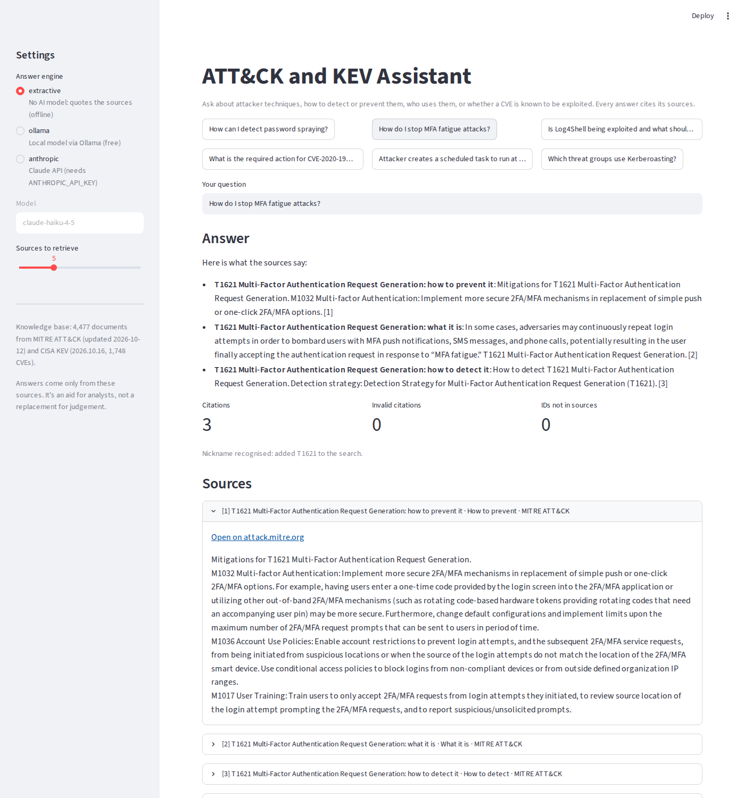

# ATT&CK and KEV Assistant (RAG)

A question-answering assistant for security analysts, built on **retrieval-augmented generation (RAG)**. It answers questions like *"How do I detect password spraying?"* or *"Is Log4Shell being exploited and what should we do?"* using only **MITRE ATT&CK** and the **CISA Known Exploited Vulnerabilities (KEV)** catalogue, cites every claim, refuses off-topic questions, and checks its own answers for invalid citations and invented IDs.



## Why I built it

Analysts look things up constantly: what a technique is, how to detect it, what to do about a CVE. A general chatbot will answer confidently even when it's wrong, and a made-up technique ID or patch deadline is worse than no answer. I wanted to see how far careful retrieval and simple guardrails go towards an assistant you can **check**: every sentence points to a source you can open.

## How it works

```
MITRE ATT&CK (STIX) ─┐                               ┌─ question
CISA KEV (JSON) ─────┴─► 4,477 small documents ─► search ─► top 5 sources ─► answer with [1][2] citations ─► checks
                         (what it is / how to         (BM25 + exact IDs        (no model, a local model       (valid citations?
                          detect / how to prevent /    + intent + aliases)      via Ollama, or Claude)         invented IDs? in scope?)
                          who uses it / KEV entry)
```

1. **Ingest** (`build_index.py`, `src/ingest.py`). Downloads the ATT&CK Enterprise bundle and the KEV catalogue and turns them into **4,477 documents**, each with one job so a citation is precise:

   | Kind | Count | Example |
   |---|---|---|
   | technique | 866 | *T1110.003 Password Spraying: what it is* |
   | detection | 725 | *...how to detect it* (ATT&CK detection strategies, analytics and log sources) |
   | mitigation | 623 | *...how to prevent it* (e.g. M1032 Multi-factor Authentication) |
   | groups | 515 | *...threat groups that use it* |
   | kev | 1,748 | *CVE-2020-1938 Apache Tomcat...*: date added, ransomware use, required action |

   Citation markers and links are stripped, and long texts are split into chunks of at most 220 words.
2. **Retrieve** (`src/retrieve.py`). Three methods, so they can be compared:
   - **TF-IDF** with cosine similarity
   - **BM25**, the classic search-engine ranking (implemented from scratch)
   - **Hybrid**: BM25, plus a strong boost for exact IDs in the question (`T1059.001`, `CVE-2023-23397`), plus **intent routing** ("detect" → detection documents, "prevent" → mitigations, "who uses" → groups, "CVE/patch/exploited" → KEV), plus **alias expansion** for nicknames analysts use (`Log4Shell` → CVE-2021-44228) from `config/aliases.json`.
3. **Answer** (`src/answer.py`). The top sources go to one of three engines:
   - `extractive`: no AI model; quotes the most relevant sentences. Works offline.
   - `ollama`: a free local model such as Qwen 2.5 7B, so nothing leaves your machine.
   - `anthropic`: Claude through the API.
4. **Guardrails**:
   - **Scope gate:** if nothing in the sources matches well enough, it says "The sources don't cover this" instead of guessing.
   - **Grounded prompt:** the model is told to use only the numbered sources and cite them like `[1]`.
   - **Injection-aware:** source text is wrapped in `<source>` tags and the model is told never to follow instructions inside them.
   - **Answer checks:** every citation must point to a real source, and any technique or CVE ID in the answer that isn't in the sources is flagged as possibly invented.

## Results

### Retrieval: does the right document come back?

**Development set** (64 questions, used while building):

| Method | Found first (hit@1) | In top 5 (hit@5) | MRR |
|---|---|---|---|
| TF-IDF | 50% | 81% | 0.62 |
| BM25 | 58% | 84% | 0.69 |
| Hybrid (no aliases) | 64% | 84% | 0.73 |
| **Hybrid + aliases** | **72%** | **91%** | **0.80** |

**Held-out set** (20 new questions written after the settings were fixed, run once):

| Method | hit@1 | hit@5 | MRR |
|---|---|---|---|
| TF-IDF | 45% | 90% | 0.62 |
| BM25 | 55% | 95% | 0.71 |
| Hybrid (no aliases) | 75% | 95% | 0.81 |
| **Hybrid + aliases** | **85%** | **95%** | **0.88** |

A hit means the right ID **and** the right kind of document: for "How do I detect Kerberoasting?", a description of Kerberoasting doesn't count.

**Scope gate:** all 4 off-topic questions were refused. 81 of 84 on-topic questions were answered; the 3 refused were the nicknames it couldn't resolve (below), so refusing was the right call there.

### Answers: does the model stick to the sources?

88 questions per engine. *Grounded* = every citation points to a real source (or it correctly says the sources don't cover it). *Invented IDs* = a technique or CVE ID in the answer that isn't in any source. *Cites right source* = at least one citation points to the document the question was about.

| Engine | Prompt | Grounded | Invalid citations | Invented IDs | Names the ID | Cites right source |
|---|---|---|---|---|---|---|
| Extractive (no model) | - | 88/88 | 0 | 0 | 75/84 | 74/84 |
| qwen2.5:7b (local) | v1 | 88/88 | 0 | 0 | 26/84 | - |
| qwen2.5:7b (local) | v2: "name the ID (e.g. T1110.003)" | 88/88 | 0 | 0 | 43/84 | 71/84 |
| llama3.2:3b (local) | v1 | 80/88 | 0 | 0 | 20/84 | - |
| **qwen2.5:7b (local)** | **v3: "copy the ID from a source title"** | **88/88** | **0** | **0** | **43/84** | **71/84** |
| llama3.2:3b (local) | v2: "name the ID (e.g. T1110.003)" | 72/88 | 0 | **6** | 42/84 | 52/84 |
| llama3.2:3b (local) | v3: "copy the ID from a source title" | 78/88 | 0 | 0 | 35/84 | 58/84 |

v1 = the original grounded prompt. v2 added a rule asking the model to name the ID, with an example. v3 kept the rule but removed the example. All runs use temperature 0. v3 is the prompt in `src/answer.py`.

### What I learned

- **Exact IDs and intent matter more than the ranking formula.** BM25 beat TF-IDF, but the big jump came from boosting exact IDs and routing "how do I detect..." to detection documents (hit@1 58% → 72% on development, 55% → 85% on held-out).
- **Search can't guess nicknames.** "Log4Shell" appears nowhere in the KEV entry (*Apache Log4j2 Remote Code Execution Vulnerability*), so without the alias list it fails. Nicknames *not* on the list (Shellshock, ProxyShell, Spring4Shell) still fail. Dense embeddings or a larger alias list would help, but each needs maintenance.
- **ATT&CK changes.** In this release, clearing Windows event logs is **T1685.005** under the new Defense Impairment tactic, not the old T1070.001. An assistant built on live data stays current; one built on a model's memory would give the old ID with confidence.
- **Misses are informative.** "Scanning the internal network for open ports" returned T1595 Active Scanning (external reconnaissance) instead of T1046 Network Service Discovery: the words overlap, the meaning doesn't. That's the kind of gap semantic embeddings close.
- **A prompt example can become a hallucination.** Adding "name the ID (e.g. T1110.003)" made qwen2.5:7b name the right ID far more often (26 → 43 of 84) with no invented IDs. The smaller llama3.2:3b started copying the example: 5 of its 6 invented IDs were T1110.003, on questions that had nothing to do with password spraying. The invented-ID check caught every one. Removing the example (v3) brought invented IDs back to 0 for both models, with no loss for qwen.
- **Model size shows up in rule-following, not just fluency.** Both local models wrote readable answers, but the 3B model dropped citations more often (78/88 grounded vs 88/88 for the 7B model, and fewer correct citations: 58 vs 71 of 84). For a tool analysts must trust, the 7B model is the minimum I'd use.
- **Measure what you mean.** My first answer metric only checked whether the ID string appeared, which scored qwen at 26/84 even when it cited the right document by name. Adding "cites the right source" (71/84) gave a fairer picture.
- **Tuning on your test set flatters you.** I picked the intent boost on the development questions, so I wrote a separate held-out set and ran it once.

> The questions are mine, so they reflect how I'd ask, not every analyst. The numbers measure retrieval on these questions, not a guarantee of correct answers.

## Run it

```bash
git clone https://github.com/vinayappajigowda/attack-rag-assistant.git
cd attack-rag-assistant
python -m venv .venv
.venv\Scripts\activate            # Mac/Linux: source .venv/bin/activate
pip install -r requirements.txt

python build_index.py             # downloads ATT&CK + KEV and builds data/corpus.jsonl (a built copy is included)
python evaluate.py                # retrieval comparison + scope gate
streamlit run app.py              # the assistant
python -m pytest                  # 10 tests
```

**Using a local model (free):** install [Ollama](https://ollama.com), run `ollama pull qwen2.5:7b`, then pick **ollama** in the app's sidebar, or run `python evaluate.py --answers ollama --model qwen2.5:7b`. See [docs/LOCAL_MODEL.md](docs/LOCAL_MODEL.md).

**Using Claude:** set `ANTHROPIC_API_KEY` (and optionally `ANTHROPIC_MODEL`), then pick **anthropic**. Never commit the key: `.env` is in `.gitignore`.

## Design decisions

- **Small, single-purpose documents.** "How to detect T1110.003" is its own document, so a citation points at exactly what supports the claim.
- **Sparse search before embeddings.** BM25 is fast, explainable and has no dependencies. It gives a baseline to measure embeddings against later.
- **A no-AI mode.** The extractive engine means the tool works offline and the retrieval can be judged on its own.
- **Refuse rather than guess.** The scope gate and the "sources don't cover this" instruction trade a little coverage for trust.
- **Check the output, don't trust it.** Citation validation and the invented-ID check run on every answer, from any model.
- **Local-first.** With Ollama, questions about your environment never leave your machine.

## Limitations and next steps

- Retrieval is lexical, so synonyms and unknown nicknames are weak; **next:** add embeddings (e.g. `nomic-embed-text` via Ollama) as a hybrid and compare on the same questions.
- Only ATT&CK and KEV; **next:** add Sigma rules, NVD descriptions and internal runbooks.
- Answer quality depends on the model; a small local model may summarise less accurately than a large one, which is why the checks exist.
- The scope threshold is a single number tuned on a few off-topic questions.

## Project structure

```
build_index.py         Download sources, build data/corpus.jsonl
evaluate.py            Retrieval comparison, scope gate, answer checks
app.py                 Streamlit assistant
src/ingest.py          ATT&CK STIX + KEV -> documents
src/retrieve.py        TF-IDF, BM25 and hybrid search
src/answer.py          Prompting, engines, guardrails, answer checks
config/aliases.json    Nicknames -> IDs
eval/                  Development (64 + 4 off-topic) and held-out (20) questions
reports/               Evaluation results and screenshot
tests/                 10 pytest tests (fixtures + real-corpus check)
```

## Data

- [MITRE ATT&CK](https://attack.mitre.org/) Enterprise, from the [mitre/cti](https://github.com/mitre/cti) repository. © The MITRE Corporation, used under the ATT&CK terms of use.
- [CISA Known Exploited Vulnerabilities Catalog](https://www.cisa.gov/known-exploited-vulnerabilities-catalog).

---

Built by **Vinay Appajigowda** · [LinkedIn](https://www.linkedin.com/in/vinay-appajigowda-822aa3206/) · [GitHub](https://github.com/vinayappajigowda)
